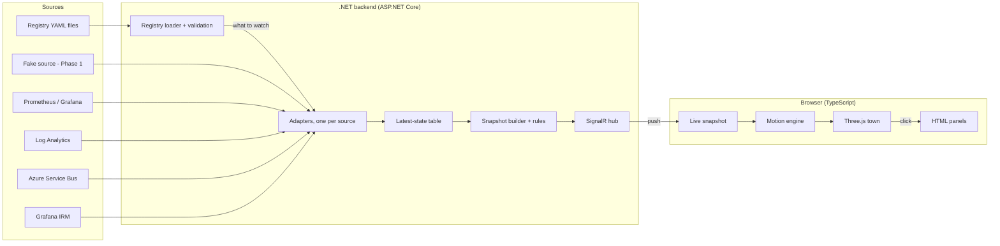

# Observability City: phased build plan

Oct 24, 2026 · Daniel · exported from the Claude Doc https://claude.ai/artifact/9GzxXsugoyXUQ8NoVc5Rou

## Summary and decisions

Observability City is a locally run browser app that shows our Azure estate as a living 3D town. Phase 1 is a demo driven entirely by a fake data adapter and a scenario switcher, so we can show what every failure mode looks like before wiring any real source. It builds on the original Observability Town brief, with the changes below.

| Topic | Decision |
| --- | --- |
| Rendering | 3D low-poly with Three.js directly (no React), using free CC0 model kits through swappable themes. Day lighting by default with a Dusk toggle |
| Layout | An island per pillar on a ring around a central hub island (Service Bus port, APIM, shared infra). An airport at the edge for outside callers, and third parties on offshore islands |
| Incidents | From Grafana IRM, shown as weather over the assigned team's island only |
| Messaging | Async = boats from the Service Bus port to team piers. Sync = walkers over bridges. DLQs are a quarantine pen with a count on the subscriber team's pier |
| Cross-team calls | Hub and spoke through APIM, with team-coloured walkers and a dependency overlay |
| Backend | .NET (ASP.NET Core + SignalR). Frontend TypeScript, because it runs in the browser |
| Running | Locally on a developer PC, read-only, no SSO. Azure hosting later |
| Sources | Pluggable adapters: Fake first, then Prometheus/Grafana, Log Analytics, Service Bus, Grafana IRM. Kafka later |

## Visual language

Each signal gets exactly one visual meaning, agreed signal by signal with Dan on 24 Oct. Colour rules: red only ever means errors, amber means warning or SLA breach, and grey means stale data, which is never shown as healthy.

| Signal | Visual |
| --- | --- |
| System | Building shaped by role: API = office tower, worker = factory, database = tanks, cache = water tower, cron = clock tower. Role is optional in YAML (fixed list) and inferred from links and telemetry when left out. A system that consumes messages also gets a pier |
| Pillar | Pillar: its own island on a ring around the hub. The central hub island (platform) holds the Service Bus port, the APIM gateway, and shared databases and caches |
| Capacity | Floors = instance count on a doubling scale (1, 2, 3–4, 5–8, 9–16, 17–32, 33–64, 65+ = 8 floors max), with the exact count on a plaque |
| Load | Lit windows: more light up as req/s rises |
| Instance health | The share of dark, cracked floors matches the share of unhealthy instances (at least one floor if any are unhealthy). The plaque reads "5/10 healthy" |
| Down | Blackout, barriers on its bridge, a "Closed for repairs" sign and repair van. Walkers turn back |
| Errors | Rooftop beacon: a bulb on a mast, green, amber or red, and red pulses. Defaults are 1% and 5%, overridable per system |
| Traffic | Number of walkers and boats |
| Latency | Walker and boat speed. A queue forms at the door or pier when p99 is over threshold |
| Over SLA | The queued crowd turns angry: stamping, with an amber "!" bubble (`slaP99Ms`, default 1 s) |
| Failed calls | Red walkers |
| Messaging | Service Bus = port on the hub. Cargo boats sail to each subscriber team's pier, and backlog = crates stacking on the pier. Water = async, bridges = sync |
| Dead letters | A red quarantine pen on the pier fills with broken crates, a red lighthouse beam flashes when above 0, and a floating count badge shows the number ("DLQ 37"). The hub shows the total |
| Incident | Weather over the assigned team's island only: sev4 light cloud, sev3 overcast, sev2 rain, sev1 storm with lightning. The worst wins, the island sign shows a count, and the rest of the town stays sunny |
| Outside callers | An airport at the map edge (plane rate = inbound traffic, with an arrivals board). Passengers walk over main bridges to islands with external systems |
| Cross-team calls | Hub and spoke, as in reality: one bridge per island to the hub, through the APIM gateway building. Walkers carry their team's flag colour. A dependency overlay draws dashed arcs from team to team, sized by volume. Calls that bypass APIM get their own direct bridge |
| Third parties | Small offshore islands with a direct bridge from each calling island. Same beacon, queue and closed rules, inferred from our outbound calls |
| Stale data | Greyed out |

## Architecture

The renderer never knows where data came from. Every source is an adapter behind one .NET interface, so the Fake source in Phase 1 is later swapped for real ones without touching the town.



The registry tells the backend what to watch. Each adapter polls on its own timer into a latest-state table. Every 5 to 10 s the snapshot builder applies the rules (an incident overrides metrics, stale data is grey) and pushes one snapshot over SignalR. The browser invents all motion (walkers, boats, planes, crates) from the rates in the snapshot.

| Topic | Decision |
| --- | --- |
| Solution | .NET Aspire AppHost starts everything with one F5: the Host (API + SignalR), Core (registry, rules, snapshot builder), one Adapters project per source, Contracts, and the `frontend/` Vite + TypeScript + Three.js frontend. `azd up` to Azure Container Apps later |
| Live push | SignalR: groups (per-pillar filtering, live log tail for an open drawer), two-way on one connection, Azure SignalR for scale-out. The snapshot builder doesn't know the transport |
| Contract | C# `Snapshot` records are the source of truth. The build emits OpenAPI for `/api/snapshot/latest`, and openapi-typescript generates `contracts.ts`, so drift is a build error. Golden snapshot fixtures per scenario are tested in both C# and TypeScript |
| Adapters | Poll per source: each source has its own background loop, interval, timeout and retry, with one batched query for all systems. A failing source greys out only its own values. No webhooks while it runs on a dev PC |
| Fake source | A generator adapter (healthy noisy baseline, with scenario effects layered on top) plus a replay mode that plays fixture timelines for tests and scripted demos |
| Azure auth | `DefaultAzureCredential`: your own az / Visual Studio login locally, managed identity once hosted. Grafana and IRM tokens in dotnet user-secrets, Key Vault when hosted, never in YAML |
| History | Parked. Live data only for the first versions (see open questions) |

## Registry config

Islands are **pillars**, described in YAML files, one file per pillar. Dan's repo holds the generic app plus sample towns in `config/` (the two fake towns), and the registry path is a setting (`Registry:Path`, default `config/galactic-credit`). A company forks it and adds only its own `config/` (real registry) and optional `extensions/` (company-only adapters), never editing core files, so `git pull upstream` merges cleanly. The demo loads the same files as production, and only the data source changes.

```
registry/
  town.yaml           # ownership tag names, Service Bus naming patterns
  defaults.yaml       # app-wide defaults per role
  sources.yaml        # named connections per environment (prod, uat, dev)
  layout.yaml         # island order
  hub.yaml            # hub resources: APIM, Service Bus, egress, shared DBs
  third-parties.yaml  # vendors with host patterns (ext.snowflake)
  pillars/cl.yaml     # one file per pillar
  scenarios/*.yaml    # demo scenarios and story timelines
  _discovered/        # drafts written by discover, never loaded
themes/
  harbour-town/theme.yaml  # building kinds -> models, anchors, Day/Dusk presets, wording
```

```yaml
# pillars/cl.yaml
pillar: cl                       # same code as Azure tag, pillar.code and Service Bus names
displayName: CL pillar          # friendly name shown on the island sign
irmTeams: [cl-oncall]            # incident weather
external: false                  # default for its systems
sources: { metrics: la-cl }      # override only the slots that differ
defaults:
  api:    { slaP99Ms: 300, errors: { amber: 0.01, red: 0.05 } }
  worker: { slaP99Ms: 30000 }
resources:                       # pillar-owned DBs and caches
  - id: cl.customer-db
    kind: sql
    sharedWith: [ams]            # intentional sharing, no warning
systems:                         # buildings are laid out in this order
  - id: cl.mgs                   # {pillar}.{service}; messaging is discovered from cl-mgs-* names
    role: api                    # optional, inferred when omitted
    external: true
    slaP99Ms: 2000               # orchestrator with many internal calls
  - id: cl.ss
  - id: cl.report-exporter       # single-tenant style: declare what names can't tell us
    publishesExternal: { via: kafka, target: ext.datahub }
```

| Topic | Decision |
| --- | --- |
| Ids | `<pillar>.<system>`. The prefix must match the file, ids are kebab-case and unique town-wide, and `aliases` keep old ids working after a rename |
| Correct references | A generated JSON schema gives autocomplete and red underlines in VS Code / Rider. The loader and CI reject unknown ids with "did you mean", and only that file is affected |
| Catalog | Generated from the registry on load, so it's always in sync. `dotnet run -- catalog` and a Registry page in the app |
| Discovery (Phase 2) | Reads Log Analytics roles and dependencies, OTel service names, Service Bus entities and Azure Resource Graph tags. The Azure `pillar` tag and `pillar.code` attribute place systems on the right island. It writes drafts to `_discovered/` only |
| Staying current | Unregistered services appear on a grey Lost & found island. A Registry health panel lists drift (no data for 7 days, undeclared or unseen calls, missing entities), each with the YAML line to fix it |
| Metrics mapping | Convention + overrides: default queries per source type on standard OTel metrics and App Insights tables, joined by service name. A system adds custom PromQL/KQL only when it's non-standard |
| Defaults | `defaults.yaml` per role (also baked into code as a last resort), then pillar `defaults` per role, then system override. The drawer shows each effective value and where it came from |
| Layout | Deterministic, no dragging. `layout.yaml` lists the island order (validated, and missing pillars are appended with a warning). One ring clockwise from the top with automatic radius. Above one ring, a staggered second ring (bridges pass between first-ring islands). `ringCapacity` (default 12, 6 to 18) sets the ring size; at most 2 rings, so at most (ringCapacity x 2) - 1 pillars. Fixed places: hub in the centre, airport in the second ring's north slot, a ring road around the town with vendors outside it, Lost & found in a corner |
| Scenarios | `scenarios/*.yaml`: a caption plus effects (target, effect, intensity), optionally on a timeline. Validated like the registry. Custom mode's Save writes the same format, and the switcher buttons are generated from the files |

**Sources, hub, messaging and third parties**

| Topic | Decision |
| --- | --- |
| Environments | Switchable in the top bar, prod by default. `sources.yaml` has a section per environment, and the registry is shared |
| Source binding | Per-signal slots (metrics, instances, calls) with town-wide defaults. Pillars or systems override only the slot that differs. Service Bus and IRM are bound globally |
| Hub | Its own `hub.yaml` listing resources (APIM, Service Bus, central egress service, shared DBs) with Azure resource ids. Up/down for all from Azure Resource Health, plus richer signals where available (APIM gateway logs, Service Bus errors and throttling) |
| Building kinds | Themes replace a buildings catalog: `themes/{name}/theme.yaml` maps each building kind to a model with anchors (beacon point, floor module height, pier attach point), plus Day/Dusk lighting presets and optional wording. A theme picker switches at runtime. The default harbour-town theme uses CC0 kits (Kenney, KayKit, Quaternius). Commercial packs stay in a private fork, never in the public repo |
| Pillar-owned resources | Stay on the owner's island. `sharedWith` declares intentional sharing (pillar-colour flags). Undeclared cross-pillar use adds an amber marker and a Registry health suggestion |
| Messaging | Discovered by naming convention for the multi-tenant platform: `{pillar}-{svc}-outbox` topics, `{consumerPillar}-{consumerSvc}-{source}-subscription`, forward chains from ForwardTo. Patterns live in `town.yaml`. Single-tenant systems declare exceptions. Message types aren't declared |
| Cross-pillar messaging | The intended pattern is a direct subscription to the other pillar's outbox. Pillar-to-pillar via egress/ingress is legacy: drawn with an amber pennant and listed for migration. Egress to external parties (e.g. Snowflake) is normal |
| Namespaces | Shared by several pillars = a port on the hub. Used by one pillar = a harbour on its island. Queues are direct boat routes |
| Third parties | `third-parties.yaml` lists vendors with host patterns, matched against dependency targets. Unknown external hosts are suggested in Registry health. Kafka/external publishing can be declared until a Kafka adapter exists |

**Staying company-neutral.** The core code knows only generic concepts: groups (islands), systems, resources, links (sync, async, external), brokers, vendors, and flags on links such as legacy or bypass. Everything company-specific is config or an adapter: the group label ("Pillar"), ownership tags, naming patterns, `topology: hub-and-spoke | direct`, and legacy rules. The Phase 1 demo ships two fake towns, one shaped like Dan's company and one deliberately different (teams, direct calls, Kafka, no gateway), and both must render with no code changes.

## Phase 1: demo town with fake sources

Phase 1 is done when someone who has never seen it can watch you click through every scenario and say what is wrong without reading a number. It uses the real architecture end to end, with only the Fake adapter behind it.

**Decisions** (agreed topic by topic with Dan on 24 Oct)

| Topic | Decision |
| --- | --- |
| Sample towns | **Galactic Credit:** 14 pillars (cl, acc, pay, frd, cus, acq, dec, bil, col, dsp, rwd, obk, ntf, dat) around a hub with APIM, the Service Bus port, central egress and a shared customer DB. Vendors: credit bureau, card network, SMS/email, Snowflake. About 40 systems, with deliberate legacy egress routes and an undeclared shared DB. **Droid Shop:** teams Web, Mobile, Inventory, Checkout, Shipping and Notifications, with Kafka, direct calls and no gateway. Switch towns in the top bar |
| Fake data | Gentle noise plus a daily traffic cycle (a day can be sped up to about 2 minutes), with floors autoscaling at peak. A Calm toggle freezes it flat. Scenarios layer on top |
| Scenarios and stories | Stackable: pick a scenario, then click a target in the town or search for one. Each active effect is a chip with an intensity slider, plus Reset all. Stories are YAML timelines of the same effects (time, caption, apply, clear, ramp), played from a story bar with play, pause, speed, scrub, captions and camera glides |
| Lighting | Day by default, with a Day/Dusk toggle remembered per browser. Beacons get halos in Day. Automatic by local time later |
| Models | Free CC0 kits (Kenney, KayKit, Quaternius) plus our own pieces (beacon, DLQ pen, signs), loaded through the theme system. Phase 1 ships the harbour-town theme. The bar is a polished, game-quality look |
| Islands | Organic coastlines generated from the pillar id (the same on every visit) and sized by system count. Inside, a town centre of square plots and streets: one building per plot, a few spare lawn plots so new systems don't reshuffle the layout, with trees and a hill around it |
| Camera | Free orbit with tilt kept between 25° and 75°, zoom and pan limits, never under the water. Click or search glides to a building and opens the inspector, and any drag cancels a glide. Home frames the whole town. Labels only on selected or troubled buildings. A wall-display mode tours troubled islands |
| UI | Top bar: town and environment switchers, town totals, search, Day/Dusk, theme, legend and Home. Break things panel on the left (demo only; scenario then click a building, chips with a strength slider, Reset, Calm and a speedable day). Inspector drawer on the right with Overview, Links, Logs and Config tabs. Story bar at the bottom. The legend opens on the first visit |
| Performance | Quality presets Low, Medium, High, Ultra and Wall (30 fps). Auto picks a starting preset from the device, then steps down or up based on measured frame time, with a manual override. Target: smooth at Medium on an ordinary office laptop. Budget of about 20 islands, 200 buildings and 600 moving walkers and boats |

Previews used for these decisions: [style and lighting](https://claude.ai/artifact/KkAR3joVpBjCkC3aS1Fv6Q), [island shapes](https://claude.ai/artifact/622xiVYcuCpTVtkbaudfar) and [UI layout](https://claude.ai/artifact/MNj7Dsx1MKbDpgZcnTXCVA). They are rough sketches, not the final art.

**Build order: a thin slice first, then widen.** Each slice ends in something demoable.

1. **The bar.** Solution skeleton (Aspire, contract, SignalR), the fake generator, and the hub plus one Galactic Credit island at final art quality, with floors, beacons and walkers driven by live fake data. This proves the look and the pipeline together.
2. **All islands.** Registry loader with validation, the full Galactic Credit registry, ring layout, organic islands with plots and streets, bridges and the camera.
3. **Messaging.** Service Bus port, boats, piers, crates, the DLQ pen, lighthouse and count badge.
4. **The other signals.** Down and instance health, latency queues and angry crowds, incident weather, the airport, vendor islands, the dependency overlay and stale grey.
5. **UI.** Top bar, inspector drawer, legend and search.
6. **Scenarios and stories.** Break things panel, chips, the story player, the daily cycle and the Calm toggle.
7. **Generality and polish.** The Droid Shop town, the Dusk preset, theme picker, quality presets and wall-display mode.

**Out of scope for Phase 1:** real sources, history and replay, recording stories by clicking, deployment crews, authentication, and themes other than harbour-town.

**Review gate:** a demo to you and a few colleagues. We tune the visuals until every scenario reads at a glance before starting Phase 2.

## Phases

Each phase ends with something demoable and a review with you before the next starts. Real sources are added one adapter at a time behind the same town.

Each phase adds real sources behind the same town.

1. **Phase 1 · Demo town with fake sources.** Fake adapter, sample registry, 3D town, scenario switcher, custom mode and detail drawer. Uses the real pipeline end to end, so later phases only add adapters. *Done when: every scenario reads at a glance in a live demo to colleagues.*
2. **Phase 2 · Telemetry: Grafana/Prometheus and Log Analytics.** Adapters for OTel metrics via the Prometheus API and KQL on AppRequests / AppDependencies. Footpaths from observed calls, per-source name mapping, and the drift report. *Done when: a handful of real systems show real state, with fake ones still filling the rest.*
3. **Phase 3 · Service Bus: depot, docks and DLQs.** Reads active and dead-letter counts per topic, queue and subscription with the admin client. Publish and consume rates from OTel messaging metrics drive the boats and pier crates. *Done when: a real dead letter fills the right team's pen.*
4. **Phase 4 · Incidents and third parties.** Grafana IRM adapter drives the weather over the assigned pillar's island. Third-party health from errors and latency on our outbound calls (http.client metrics). *Done when: a real incident changes the sky over the right island.*
5. **Phase 5 · Make it trustworthy.** Stale-data greying, hysteresis, healthcheck polling, snapshot history and replay (parked). Deployment crews from CI/CD events, performance budget checks. *Done when: the team would rely on it during a real incident.*
6. **Phase 6 · Host and grow.** Host in Azure with Entra ID sign-in, and per-team filtering if needed. Kafka adapter, Kubernetes runtime adapters, more teams and sources. *Done when: decided when we get there.*

Phases 2 to 4 can be reordered: if DLQs are the most painful today, Service Bus can come before telemetry, since the depot and docks are already built in Phase 1.

## Risks and open questions

The biggest risk is the registry mapping, not the 3D. The same system has different names in OTel, Log Analytics, Service Bus and IRM, and the registry is what ties them together.

- **Visual noise.** Too many walkers and effects hide the signal. Walkers are sampled and capped, and states change with hysteresis so nothing flickers.
- **False green.** Missing data must render grey, never healthy.
- **Performance on ordinary laptops.** Instanced meshes for walkers and vans, game-style quality presets with automatic stepping, and a target of smooth Medium on an office laptop.

Open questions for later phases:

- [ ] Grafana IRM: which API or webhook gives open incidents, and how do they map to systems (labels, service tags)?
- [ ] Which Log Analytics workspaces and Grafana/Prometheus instances, and what does the OTel naming look like today?
- [ ] Service Bus: which namespaces, and is read access by Azure CLI login or managed identity acceptable locally?
- [ ] Third parties: which vendors matter most, and do we want their status pages as a second signal?
- [ ] Where should it live after Phase 5 (Azure App Service, Container Apps, internal only)?

* [ ] History and replay (parked): snapshot frequency, store (Cosmos with native TTL via the Aspire emulator, or SQLite), and retention (e.g. 90 days with downsampling after 7 days, about 5 GB rather than 23 GB at full resolution).
